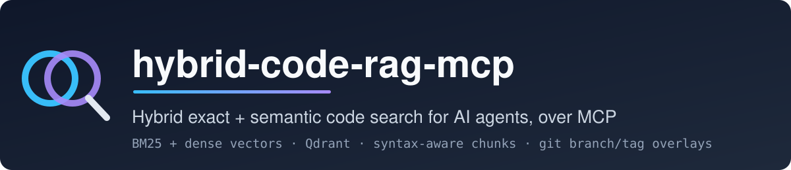
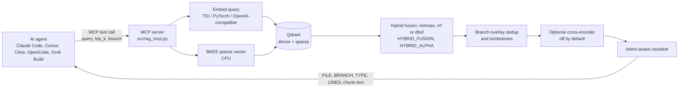
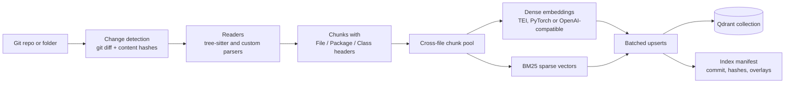

<p align="center">
  
</p>

<p align="center">
  <a href="LICENSE"></a>
  
  <a href="https://modelcontextprotocol.io"></a>
  <a href="https://qdrant.tech"></a>
  <a href="#supported-languages-and-file-types"></a>
</p>

**A local code search engine for AI agents: an incremental indexer, hybrid (dense + BM25) retrieval and an MCP server.** Code is chunked along its syntax and indexed in Qdrant with BM25 and dense vectors; after the first build, each refresh re-embeds only the files changed since the last indexed commit. The MCP server is one interface on top of the indexer and the retrieval engine: it serves search to Claude Code, Cursor, Cline, OpenCode, Grok Build or any MCP client as a tool.

## At a glance

| | |
|---|---|
| **Search** | BM25 + dense embeddings in one query, fused with min-max score fusion (default), Reciprocal Rank Fusion or distribution-based score fusion ([hybrid fusion](docs/hybrid-fusion.md), `HYBRID_FUSION`, `HYBRID_ALPHA`), then an intent-aware reranker with per-language profiles ([reranker](#reranker)) |
| **Chunking** | One chunk per method / SQL object, plus class summaries; every chunk carries a `// File / // Package / // Class` header |
| **Languages** | Java, Kotlin, Groovy, C#, Go, Rust, PHP, JavaScript, TypeScript, Python, C, C++, Delphi/Pascal, SQL (T-SQL, PostgreSQL), plus Qt `.ui`, Delphi forms, Hibernate, JasperReports, shell/PowerShell scripts and text/config files ([table](#supported-languages-and-file-types)) |
| **Git** | Incremental refresh from `git diff`; branch and moving-tag overlays store only the files that differ from main |
| **Runs on** | Your machine: Python 3.12 + Docker (Qdrant, TEI). No hosted API. GPU recommended for indexing, CPU is fine for queries ([hardware](#hardware)) |
| **MCP tools** | `search_rag` (query, top_k, branch; name configurable per index) and `get_index_state` (indexed commit, freshness) |
| **Clients** | Claude Code, Cursor, Cline, Claude Desktop, OpenCode, Grok Build; stdio and streamable HTTP |

**Why**

- **Exact names and concepts in one query.** Agents usually find code with `grep` or pure vector search. `grep` needs the exact identifier; vector search finds concepts but misses exact names such as `@OrderId` or `PrepareDataSet`. Running both in one query lets the same tool answer "where is `calculateDiscount` called?" and "how is the SFTP upload retried?".
- **Built for large codebases: index once, then refresh only what changed.** Embedding every chunk of a repository with hundreds of thousands of lines is the expensive part. On a typical developer laptop without a suitable GPU it can take many hours, so building the index locally on every machine is not practical. hybrid-code-rag-mcp builds the full index once, ideally on a machine with a GPU. After that, each refresh reads `git diff` against the last indexed commit and re-embeds only the added and changed files, so keeping the index current takes seconds to minutes and runs fine on a CPU. Branches and release tags are stored as small overlays over the main index instead of full copies. One index server can then serve the whole team over streamable HTTP, and each developer's agent only sends queries, which need no GPU.
- **The indexing cost buys understanding.** Tools that only parse code into a symbol or call graph can index a large repository in minutes, because they compute no embeddings. They answer structural questions well ("who calls `X`?"), but a natural-language question such as "where do we handle expired sessions?" finds nothing unless some identifier literally contains those words. hybrid-code-rag-mcp deliberately pays a one-time embedding cost per chunk so that queries by intent also work, while BM25 in the same query still catches exact names. Embeddings are computed locally (TEI or any OpenAI-compatible server), with no paid API, and after the first build only changed files are re-embedded.
- **A bridge from tickets to code.** Bug reports and feature requests are written in the language of the application, not the code: button captions, window titles, page names, messages users see. The index covers UI definitions (forms, `.ui` and `.dfm` files, reports, templates) and code alike, so an agent can take a ticket such as "the Save button on the invoice screen does nothing" and find the form that shows that caption and the handler behind it, even when no class or method name matches the ticket's words.

## Supported languages and file types

| Language / format | Extensions | How it is parsed |
|---|---|---|
| Java | `.java` | tree-sitter (`java`): classes, interfaces, enums, records, methods, import groups |
| Kotlin | `.kt`, `.kts` | tree-sitter (`kotlin`): classes, objects, companion objects, top-level and extension functions, `.kts` script bodies ([details](docs/kotlin-chunking.md)) |
| Groovy | `.groovy` | tree-sitter (`groovy`): classes, methods, constructors, enums, import groups |
| JavaScript / TypeScript | `.js`, `.jsx`, `.mjs`, `.cjs`, `.ts`, `.mts`, `.cts`, `.tsx` | tree-sitter (`javascript` for JS and JSX; `typescript` for `.ts`/`.mts`/`.cts`; `tsx` for `.tsx`): ES modules, IIFE, prototype OOP, React components, classes with methods and fields, TS interfaces, type aliases and enums; a JSDoc or `//` block directly above a declaration stays in that declaration's chunk |
| Python | `.py`, `.pyi` | tree-sitter (`python`): Java-style chunks — class summaries with signatures and docstrings, methods, `__init__` as constructor, module constants and fields, import groups, module docstring, top-level script code ([details](docs/csharp-go-php-python-chunking.md)) |
| C# | `.cs` | tree-sitter (`csharp`): block, nested and file-scoped namespaces; classes, structs, interfaces, records, enums; methods, constructors, properties, fields, events, delegates, `///` doc comments, `using` groups, top-level statements ([details](docs/csharp-go-php-python-chunking.md)) |
| Go | `.go` | tree-sitter (`go`): structs and interfaces as class summaries listing the methods declared in the same file, functions and methods (receiver as class), `New<Type>` constructors, `const`/`var` blocks, import groups ([details](docs/csharp-go-php-python-chunking.md)) |
| Rust | `.rs` | tree-sitter (`rust`): structs, enums and unions as class summaries listing the methods of every `impl` in the same file, traits, impl blocks, functions and methods (impl type as class), `new` constructors, `const`/`static`/`type`, `macro_rules!` and item-level macro calls, inline modules, `///` doc comments and attributes, `use` groups ([details](docs/rust-chunking.md)) |
| PHP | `.php` (`.blade.php`, `.phtml` as text) | tree-sitter (`php`): namespaces, classes, interfaces, traits, enums, methods, properties, constants, `/** */` doc blocks, `use` groups, top-level functions and script code; template-like files fall back to text splitting ([details](docs/csharp-go-php-python-chunking.md)) |
| C / C++ | `.c`, `.h`, `.cpp`, `.cc`, `.cxx`, `.hpp`, `.hh`, `.hxx`, `.ino` | tree-sitter (`c` for `.c`; `cpp` for the rest): class overview, class summary, one chunk per function (`Class::method` definitions carry the class; leading comments and kernel-doc attached; macro-defined functions), declaration, include and macro groups, initialized tables |
| Delphi / Object Pascal | `.pas`, `.dpr` | tree-sitter (`pascal`): class summaries, method grouping |
| SQL | `.sql` | T-SQL by default (tree-sitter `sql`, then a heuristic T-SQL chunker); per-path `sql_dialect = "postgresql"` switches to a PostgreSQL statement chunker |
| Delphi forms | `.dfm` | custom depth-tracking parser (form header, component groups) |
| Delphi projects | `.dproj` | XML parser (project overview, build configurations, units) |
| Qt Designer forms | `.ui` | XML parser (form header, widgets, visible strings, signal/slot connections). `UI_CHUNK_CONTEXT` (default off) adds form context and a size floor; see [configuration](docs/configuration.md#qt-designer-forms-ui) |
| Hibernate mappings | `.hbm.xml` | XML parser (entity, table, columns, associations) |
| JasperReports | `.jrxml` | XML parser (report overview, parameters, fields, expressions) |
| FastReport | `.fr3` | XML parser (scripts, memos, bands) |
| Shell, PowerShell and batch scripts | `.sh`, `.bash`, `.zsh`, `.ps1`, `.psm1`, `.bat` | sentence-aware text splitting |
| Text and config | `.md`, `.txt`, `.json`, `.jsonc`, `.yml`, `.yaml`, `.toml`, `.xml`, `.xsd`, `.wsdl`, `.html`, `.htm`, `.jsp`, `.css`, `.scss`, `.properties`, `.gradle`, `.http`, `.ini`, `.cfg`, `.blade.php`, `.phtml` | sentence-aware text splitting |

Readers are registered in `src/shared/readers/__init__.py` (`READER_REGISTRY`). Adding a language is one new module plus one registry line; see [CONTRIBUTING.md](CONTRIBUTING.md#how-to-add-a-reader-for-a-new-language).

## How it works

**Query path**



**Indexing path**



## Hybrid fusion

Each query runs a dense (embedding) and a sparse (BM25) search and fuses the two result lists before the reranker. `HYBRID_FUSION` chooses how: `"minmax"` (default, score min-max scaling), `"rrf"` (reciprocal rank fusion) or `"dbsf"` (distribution-based score fusion). `HYBRID_ALPHA_MODE = "adaptive"` can pick the dense weight per query from the query's shape (identifier, mixed, natural language); the default `"fixed"` uses `HYBRID_ALPHA` for every query. Keep the defaults (`"minmax"`, `"fixed"`): in our measurements nothing beat them overall, and adaptive alpha with its default identifier weight made identifier queries worse. Modes, formulas, query-shape rules and measured results: [docs/hybrid-fusion.md](docs/hybrid-fusion.md).

## Reranker

After fusion, `src/shared/reranker.py` re-scores the candidates. The core is language-neutral: it detects overview questions ("what is `OrderService`?", "explain the `Parser` class"), extracts the target file or class, and promotes class overviews and summaries of that target. Language- and format-specific rules (node types, file-stem patterns, test paths, declaration forms, glue layers) live in a `RerankProfile` attached to each reader, so a project is only influenced by the profiles of the languages it indexes. `RERANK_PROFILES = ["java", "sql"]` (or `"all"`) in a project config overrides the selection.

The same pass applies query-intent rules to every query:

- a code-shaped identifier (`load_items`, `findById`, `Store::flush`, `Cache.evict`) promotes the chunk that **declares** it over chunks that only use it;
- test files are demoted unless the query is about tests;
- C/C++ glue layers (JNI, C API wrappers) and declaration-only headers are demoted unless the query asks for them;
- an exact class-name match beats a class whose name merely contains it (`Parser` vs `ParserOptions`).

Before reranking, each hybrid leg fetches a deeper candidate list (`HYBRID_PREFETCH_K`, default 100) and an exact symbol lookup adds the chunks that declare an identifier named in the query (`SYMBOL_LOOKUP_K`). Pool-level rules then demote chunks that only call or mention the named identifier, prototypes when the body is in the pool, and `tests/` / `tools/` paths unless the query is about them; queries about several places get at most two results per file.

An optional cross-encoder stage (`RERANK_CROSS_ENCODER_MODEL`, off by default) can re-score a small fused pool before the heuristic rules. A small CPU-capable model (`jinaai/jina-reranker-v1-turbo-en`, pool 16, weight 0.3, about 1 s/query on CPU) is the recommended starting point for repositories where it measures better; see [docs/reranker.md](docs/reranker.md#optional-cross-encoder-stage).

All of this is query-time: tuning it needs no reindex. Details and score values: [docs/reranker.md](docs/reranker.md).

## Requirements

- **Python 3.12** and [uv](https://docs.astral.sh/uv/) (or pip).
- **Docker** (Docker Desktop on Windows/macOS). In the default local mode the indexer and the MCP server create and start the Qdrant and TEI containers themselves. A remote Qdrant is also supported.
- **git**, for `git_repo` sources and overlays.
- For TEI on an NVIDIA GPU: a recent NVIDIA driver, plus the NVIDIA Container Toolkit on Linux (Docker Desktop with the WSL 2 backend on Windows provides GPU access).
- Developed and used mainly on Windows; `.sh` launchers are provided for Linux/macOS.

### Hardware

The default dense model is [`jinaai/jina-embeddings-v2-base-code`](https://huggingface.co/jinaai/jina-embeddings-v2-base-code) (161M parameters, 768 dimensions), served by [Text Embeddings Inference (TEI)](https://github.com/huggingface/text-embeddings-inference). BM25 always runs on the CPU.

- **Querying works on CPU.** A query embeds one short text, so a CPU-only TEI container (or the PyTorch backend on CPU) is enough for the MCP server.
- **Indexing works on CPU, but is much slower.** Embedding every chunk of a large repository is where a GPU pays off. An NVIDIA GPU is recommended for large codebases; TEI picks a CUDA image that matches the card automatically and falls back to the CPU image when there is no GPU.
- **VRAM**: with TEI in float16, the default settings are usually enough on an 8 GB card for small (~150M-parameter) models such as the default one. See the [VRAM tuning guide](docs/vram-tuning.md) for every parameter, an 8 GB example, CPU-only TEI settings and OOM troubleshooting.
- Other backends: PyTorch (CUDA or CPU), OpenVINO (Intel GPUs) and any OpenAI-compatible `/v1/embeddings` server such as `llama-server`. See [Installation](docs/installation.md).

An index can be built on one machine and queried from another (remote Qdrant), but the query side still needs the same embedding model to embed queries.

## Quick Start

### 1. Install

```bash
git clone https://github.com/jakubstuglik/hybrid-code-rag-mcp.git
cd hybrid-code-rag-mcp
uv venv --python 3.12
source .venv/bin/activate            # Windows: .venv\Scripts\activate
uv pip install -r requirements/requirements.txt
```

TEI runs in Docker, so no CUDA Python packages are needed for the default setup. For the PyTorch or OpenVINO backends see [Installation](docs/installation.md).

### 2. Try it on this repository

The repository ships a ready config that indexes its own source code:

```bash
python src/index_rag.py --config self-index --yes
```

This one command starts (or creates) the Qdrant and TEI containers defined by the config, downloads the model on the first run, and builds the index. Run it from the repository root, with `master` checked out.

### 3. Index your own project

Create `project-configs/my_project/config.py` (the `project-configs/` folder is git-ignored, so private configs stay local). Anything you do not set is inherited from the root `config.py`:

```python
# project-configs/my_project/config.py
SOURCE_DIRS = [
    {
        "type": "git_repo",
        "path": "../my-project",        # relative to the hybrid-code-rag-mcp folder
        "main_branch": "main",
        "sources": [
            {"path": "src", "extensions": [".java", ".kt", ".ts", ".sql", ".md"]},
            # Optional: exclude patterns + gitignore (RESPECT_GITIGNORE=True by default)
            # {"path": "modules", "extensions": [".java"], "exclude": ["build"]},
        ],
    },
]
COLLECTION_NAME = "my_project_rag"       # unique per index; Qdrant container becomes qdrant-my_project_rag
MODEL_PATH = "index_my_project"
QDRANT_PORT = 6333                       # pick a free port per index
MCP_SERVER_NAME = "my-project-rag"
MCP_TOOL_NAME = "search_my_project"
MCP_PORT = 8125                          # HTTP transport only
```

```bash
python src/index_rag.py --config my_project --yes           # first build, later incremental refresh
python src/index_rag.py --config my_project --clear --yes   # full rebuild
```

By default (`RESPECT_GITIGNORE = True`), `git_repo` sources skip files ignored
by git; tracked files are always indexed. The **first refresh after
upgrading** removes those paths from an existing index; set
`RESPECT_GITIGNORE = False` to keep the old behaviour. Parsing stays
sequential unless you set `INDEX_PARSE_WORKERS`. On very large repositories
set `MANIFEST_SAVE_INTERVAL_S = 60` so the manifest is saved once a minute in
the background instead of after every batch, and `LOG_REFRESH_CHANGES_MAX = 50`
to shorten the start-of-run change list. For C/C++ trees with large generated
headers (register maps with thousands of `#define` lines), set
`SYMBOLS_PER_SPLIT_PART = True` before the first build so split chunks do not
each carry the whole group's symbol list (reindex if you enable it later). See
[Configuration](docs/configuration.md).

The index data lives in `project-configs/my_project/qdrant/`. See [Configuration](docs/configuration.md) for all options, including branch and tag overlays and SQL dialects.

### 4. Connect your MCP client

The server entry point is `src/rag_mcp.py --config <name> --transport stdio|streamable-http`. The launcher scripts `scripts/start_rag_mcp_stdio.sh` / `.bat` set `PYTHONPATH` and use the project's `.venv`. Replace `/path/to/hybrid-code-rag-mcp` below with your clone.

**Claude Code**

```bash
claude mcp add my-project-rag -- /path/to/hybrid-code-rag-mcp/scripts/start_rag_mcp_stdio.sh my_project
# Windows
claude mcp add my-project-rag -- cmd /c C:\path\to\hybrid-code-rag-mcp\scripts\start_rag_mcp_stdio.bat my_project
```

**Cursor** (`.cursor/mcp.json` in your project, or `~/.cursor/mcp.json`) and **Cline / Claude Desktop / other stdio clients** (same `mcpServers` format):

```json
{
  "mcpServers": {
    "my-project-rag": {
      "command": "/path/to/hybrid-code-rag-mcp/scripts/start_rag_mcp_stdio.sh",
      "args": ["my_project"]
    }
  }
}
```

On Windows:

```json
{
  "mcpServers": {
    "my-project-rag": {
      "command": "cmd",
      "args": ["/c", "C:\\path\\to\\hybrid-code-rag-mcp\\scripts\\start_rag_mcp_stdio.bat", "my_project"]
    }
  }
}
```

**Grok Build** ([MCP docs](https://docs.x.ai/build/features/mcp-servers)): add it with the CLI (everything after `--` is the server command; `--scope project` writes `.grok/config.toml` in the current directory instead of `~/.grok/config.toml`):

```bash
grok mcp add my-project-rag -- /path/to/hybrid-code-rag-mcp/scripts/start_rag_mcp_stdio.sh my_project
# Windows
grok mcp add my-project-rag -- cmd /c C:\path\to\hybrid-code-rag-mcp\scripts\start_rag_mcp_stdio.bat my_project
```

or declare it in `~/.grok/config.toml` (or a project `.grok/config.toml`):

```toml
[mcp_servers.my-project-rag]
command = "/path/to/hybrid-code-rag-mcp/scripts/start_rag_mcp_stdio.sh"
args = ["my_project"]
startup_timeout_sec = 180   # default 30; the first start may create the Qdrant/TEI containers
```

Grok Build also picks up servers from `.cursor/mcp.json` and project `.mcp.json` files.

**OpenCode** ([MCP docs](https://opencode.ai/docs/mcp-servers/)): `opencode.json` in your project root, or `~/.config/opencode/opencode.json` globally:

```json
{
  "$schema": "https://opencode.ai/config.json",
  "mcp": {
    "my-project-rag": {
      "type": "local",
      "command": ["/path/to/hybrid-code-rag-mcp/scripts/start_rag_mcp_stdio.sh", "my_project"],
      "enabled": true,
      "timeout": 120000
    }
  }
}
```

On Windows use `"command": ["cmd", "/c", "C:\\path\\to\\hybrid-code-rag-mcp\\scripts\\start_rag_mcp_stdio.bat", "my_project"]`. `timeout` (ms, default 5000) is how long OpenCode waits for the tool list; raise it because the server loads the index on startup.

The launcher scripts change to the repository root first, because config names and relative source paths are resolved from there, and then run `.venv`'s Python. If you call `src/rag_mcp.py` directly, start it from the repository root.

On startup the server makes sure the Qdrant (and TEI) containers are running and loads the index, which can take a few seconds; clients with a short MCP startup timeout may need it raised. `--lazy-init` defers loading to the first request.

**HTTP clients**

```bash
scripts/start_rag_mcp_http.sh my_project      # serves http://localhost:8125/mcp (MCP_PORT)
```

```json
{ "mcpServers": { "my-project-rag": { "url": "http://localhost:8125/mcp" } } }
```

```bash
grok mcp add --transport http my-project-rag http://localhost:8125/mcp      # Grok Build
```

```json
{
  "$schema": "https://opencode.ai/config.json",
  "mcp": {
    "my-project-rag": { "type": "remote", "url": "http://localhost:8125/mcp", "oauth": false }
  }
}
```

The HTTP transport binds to `MCP_HOST`, which defaults to `0.0.0.0`. Set `MCP_HOST = "127.0.0.1"` in the project config if the server should not be reachable from other machines. More examples (OpenCode with paths relative to the git root, the self-index server) are in [docs/mcp-server.md](docs/mcp-server.md).

### MCP tools

Each server exposes two tools (names are configurable):

| Tool | Arguments | Returns |
|---|---|---|
| `search_rag` (`MCP_TOOL_NAME`) | `query`, `top_k`, optional `branch` (a configured overlay name) | Ranked chunks with `FILE`, `BRANCH`, `DISK_PATH`, `TYPE`, `LINES` and the chunk text |
| `get_index_state` | none | Last index time, indexed commit(s), overlays, point count, embed backend, and whether `HEAD` still matches the index |

## Documentation

| Topic | Where |
|---|---|
| Full installation (CUDA, OpenVINO, TEI, OpenAI-compatible servers, Qdrant modes) | [docs/installation.md](docs/installation.md) |
| Configuration and the full parameter reference | [docs/configuration.md](docs/configuration.md) |
| Hybrid fusion modes (minmax, rrf, dbsf) and query-adaptive alpha | [docs/hybrid-fusion.md](docs/hybrid-fusion.md) |
| Reranker: generic core, per-language profiles, query-intent rules | [docs/reranker.md](docs/reranker.md) |
| Indexing: CLI, pipeline, performance, cron, upgrade notes, validation runs | [docs/indexing.md](docs/indexing.md) |
| Git branch and moving-tag overlays | [docs/git-overlays.md](docs/git-overlays.md) |
| MCP server, launcher scripts, OpenCode and Grok Build integration | [docs/mcp-server.md](docs/mcp-server.md) |
| Tuning GPU memory (VRAM) | [docs/vram-tuning.md](docs/vram-tuning.md) |
| Writing retrieval validation tests | [docs/validation/validation-tests-guide.md](docs/validation/validation-tests-guide.md) |
| Design notes and benchmarks | [docs/features/](docs/features/) |
| Change history and upgrade notes | [CHANGELOG.md](CHANGELOG.md) |

## Versioning

Releases follow [Semantic Versioning](https://semver.org/) in its 0.x form and
are tagged `vX.Y.Z`. PATCH releases only fix things; MINOR releases add
features or change defaults. Until 1.0, a change that needs a reindex or a
config change is also a MINOR release, marked **Reindex required** or
**Config change required** in [CHANGELOG.md](CHANGELOG.md). Check the version
with `python src/index_rag.py --version`; `get_index_state` shows which version
built the index.

## Development

```bash
uv pip install -r requirements/requirements_dev.txt
python -m pytest            # src_test/
python -m pytest -q tests   # git overlay tests
```

See [CONTRIBUTING.md](CONTRIBUTING.md) for the project layout and a step-by-step guide to adding a language reader.

## Disclaimer

**This project is in active development.** It is provided as-is with no warranty.
I don't guarantee I will be able to incorporate any pull requests, but I will do my best to respond to issues.

## License

Licensed under the Apache License, Version 2.0; see [LICENSE](LICENSE) and [NOTICE](NOTICE). The whole codebase, including versions previously released under AGPLv3, is available under Apache-2.0.
